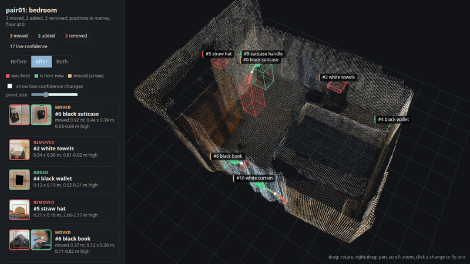
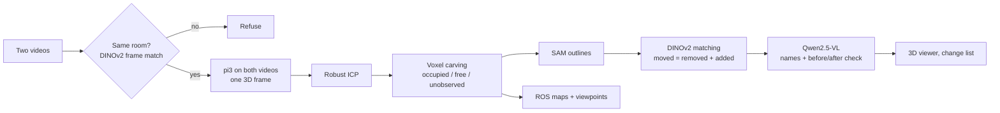

# What changed in the room?

Two phone videos of the same room, before and after. `roomdiff` builds **one 3D model from both**, finds what was **moved, added or removed**, **names** each change, and shows it in an interactive **3D viewer**. It also writes robot-ready maps: ROS occupancy grids with a change layer, and suggested places to stand for anything it could not see.



*pair01 (bedroom). Red: where something was. Green: where it is now. Arrows run from an object's old place (red) to its new place (green). Cards show each change's before and after crops; click one to fly to it.*

## Try it

- **No setup:** open the hosted page **https://termvato--roomdiff-app-web.us-east.modal.run**, drop a before and an after video, and press Run. It takes 5 to 10 minutes on a cloud GPU. It is capped at 20 runs a day, and videos are deleted after the run.
- **Finished examples:** `examples/pair01_bedroom.html` and `examples/pair02_corridor.html` are self-contained pages. Download one and open it in a browser, or open it from the hosted page.

## Run it yourself

You need [uv](https://docs.astral.sh/uv/) and `ffmpeg`. uv installs Python 3.12 and every dependency from `uv.lock`.

```bash
git clone <this repo> && cd spatial-project
uv sync --group gpu
```

**A. On your own NVIDIA GPU** (driver >= 525):

```bash
uv run roomdiff run before.mp4 after.mp4 --out results/
```

- Defaults need about 24 GB of GPU memory. pi3 takes about 16 GB for 120 frames per video, and the VLM about 16 GB afterwards.
- On a smaller GPU, cap the frames and skip the names: `--max-frames 15 --no-labels`. Tested on an 8 GB laptop RTX 4070: 7 minutes, but fewer frames find less (pair01: 3 of 6 changes instead of 5).
- Model weights (pi3, SAM ViT-H, DINOv2, Qwen2.5-VL-7B) download on first use, about 20 GB in total.
- CPU-only is not practical.

**B. On a Modal GPU** (no local GPU needed; a [Modal](https://modal.com) account with a payment method, about $0.3 per run):

```bash
uv run modal setup                       # once: log in
uv run modal deploy infra/modal_app.py   # once: GPU pipeline + your own copy of the upload page
uv run roomdiff run before.mp4 after.mp4 --out results/ --modal
```

**C. The upload page on your machine:** `uv run roomdiff serve` (local GPU) or `uv run roomdiff serve --modal`, then open http://127.0.0.1:8000.

### For scripts and automated tests

| Exit code | Meaning |
|---|---|
| 0 | done; `results/summary.json` has the change list |
| 3 | refused: the two videos do not show the same room |
| 1 | failed (error on stderr) |

`summary.json` contains:
- `changes`: id, kind (`added` / `removed` / `moved`), label, `confident`, and the `before` and `after` boxes (map-frame centre x, y in metres, size, bottom and top height above the floor), plus `distance` for moves
- `room_score` and `overlap_3d`
- `warning`, when the visits barely overlap in 3D

### Recording tips

- 30 to 60 s per video. Walk slowly, keep objects in view for a few seconds, and cover the same space in both videos from somewhat different paths.
- Move, add or remove a few objects of shoebox size or larger between the videos.
- Avoid mirrors: they create phantom geometry.

## What you get (`results/`)

| File | What |
|---|---|
| `viewer.html` | interactive 3D page: both visits' point clouds, change boxes, moved arcs, names, crops, robot map |
| `summary.json` | change list for machines (see above) |
| `changes.json` | full change list with blob ids, views, VLM answers |
| `before/after.{pgm,yaml}`, `look_mask.*` | ROS `map_server` occupancy maps and the "go look here" layer |
| `viewpoints.json`, `map.png` | where to stand to see unobserved regions; top-down map with changes |
| `changes.jpg`, `crops/` | the frames each change was seen in |

## How it works



A camera ray that passes through a voxel proves that voxel empty. Comparing what each visit saw as occupied, empty or unseen gives added, removed and unobserved space, and light changes do not create geometry. The design note explains each choice and its alternatives: **[docs/design.md](docs/design.md)**.

## Results

| | Our bedroom (pair01) | Our corridor (pair02) | SceneDiff benchmark, 5 held-out pairs |
|---|---|---|---|
| **roomdiff** | 5 of 6 found, 1 confident false alarm | 4 of 4 found (3 confident), 2 confident false alarms | AP 23.1 (typed 21.4) |
| SceneDiff (ECCV 2026) | 3 of 6 | 3 of 4 | AP 32.0 (typed 15.8) |

- roomdiff is better at telling *what kind* of change happened; SceneDiff finds more small objects.
- Our two rooms were used during development.
- 5 benchmark pairs are too few to rank the two methods.
- Every number comes from a test with its rule written in advance: [docs/spikes.md](docs/spikes.md).

## Limitations

- Small objects (a pen) can be missed. Some names are wrong (the blue tool is called "black book").
- The VLM's before/after check is noisy, so low-confidence changes are listed, not hidden.
- Scale comes from assuming the phone is held 1.5 m above the floor (1.9% off on pair01).
- Mirrors create phantom geometry.
- Offline only: about 6 minutes per pair on an A100.

## Repository

| Path | What |
|---|---|
| `src/roomdiff/` | the package: `run.py` (whole pipeline), `recon.py` (pi3), `analyse.py`, `visibility.py` (carving), `report.py`, `labelling.py`, `view3d.py`, `web.py`, `cli.py` |
| `infra/` | Modal apps: `modal_app.py` (pipeline + public page), benchmark and model-comparison runners |
| `tools/` | development and benchmark scripts |
| `tests/` | `uv run pytest` |
| `docs/` | design note, decisions, tests with pre-written rules, research notes |

Models: pi3 (yyfz/Pi3), SAM ViT-H (Apache 2.0), DINOv2 (Apache 2.0), Qwen2.5-VL-7B-Instruct (Apache 2.0). See each project for its licence and weight terms.
