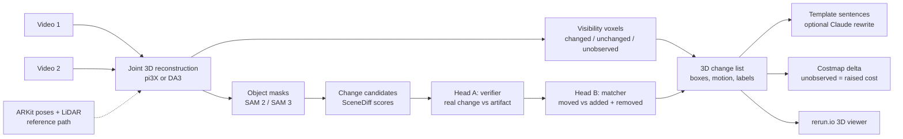

# Knowledge map

Start here. Every other doc is linked from this page. Update the status board at the end of each work unit.

## Status board (2026-10-11)

| Area | State | Next action | Owner |
|---|---|---|---|
| S1 SceneDiff on 5 val pairs (Modal) | **PASS**: fork SceneDiff; 7 TP, 30 FP, 6 FN | cut SAM cost before scaling | Claude |
| S2 own phone pair | **borderline**: 3 of 6 found (2 fully right), 4 false alarms; pipeline viable | superseded by S6 | done |
| S6 keyframes (coverage x sharpness x no-finger) | **FAIL**: same 3 of 6, 7 false alarms; frame choice not the bottleneck | keep uniform; finger filter kept | done |
| S8 geometric veto | done as fusion in S9 (model depth, not LiDAR) | | done |
| S9 3D-first on plain video | **(a) PASS** pair01; **(b) 18.0 AP held-out (band: 3D core + SceneDiff channel)**; pair01 5 of 6 found | 30-pair held-out test (~$6.5) | user |
| D11 model + pipeline shape | proposed | decide | user |
| pair02 capture (better hygiene, same lighting) | user recording | run SceneDiff + S7 map on it | user |
| S7 LiDAR 3-state change map | **works**: suitcase move found in 3D, blanket partial, hat = unobserved; 2 edge FPs | fuse with SceneDiff (head A) | Claude |
| S3 Isaac render speed | **PASS** 9.4 fps, 4.4 GB | none | done |
| S4 keyless vs gated models | blocked on S1 | run after S1 | Claude |
| S5 reconstruction models (pi3, Pi3X, VGGT, DA3, MapAnything) | **done**: Pi3X best geometry, pi3 best change detection | D11 decision | user |
| Training data choice (SceneDiff val / 3RScan / Isaac) | open | decide after S1 | user |
| Plan (`plan.md`) | not written | write after S1 + S2 | Claude |

## Pipeline (target design, D8)

## Data sources

| Source | Size | Labels | Licence | Where | Role |
|---|---|---|---|---|---|
| SceneDiff benchmark | 350 pairs (100 val / 250 test) | 2D masks + change type | MIT | Modal volume `scenediff:/scenediff_benchmark` | baseline + headline test |
| 3RScan | 1,004 rescans, 3,323 3D moves | 3D transforms, removed | CC BY-NC-SA 4.0 | metadata `data/raw/3rscan/3RScan.json`; scans not downloaded | candidate real 3D training data |
| Own iPhone pairs | 0 so far (target 6-10) | own notes + ARKit + LiDAR | ours | `data/raw/pairNN/` | demo + held-out real test |
| Isaac Sim synthetic | 0 (renderer proven, S3) | exact 3D | ours | `spikes/s3_isaac_render.py` | optional; robot demo env |

## Models and weights

| Model | Use | Access | Where |
|---|---|---|---|
| DINOv3 ViT-H+/16, L/16, B/16 | appearance features | granted; links expire 2026-10-13 | Modal volume `scenediff:/weights` |
| SAM ViT-H (v1) | SceneDiff masks | open | baked into Modal image |
| SAM 3 | our masks (S4) | granted (HF) | HF cache when used |
| pi3 | SceneDiff geometry | open (non-commercial) | HF cache volume `hf-cache` |

## Documents

| Doc | What it holds |
|---|---|
| [challenge.md](challenge.md) | the brief, verbatim |
| [decisions.md](decisions.md) | D1-D8, each with reason; append-only |
| [spikes.md](spikes.md) | S1-S5 with pre-written rules and results |
| [ideas.md](ideas.md) | I1 Isaac pairs, I2 co-training, I3 3RScan |
| [research.md](research.md) | first-pass notes on SceneDiff and models |
| [deep-research.md](deep-research.md) | full state-of-the-art report with ranked choices |
| `../research_notes/` | raw notes behind the deep research |

## Code

| Path | What |
|---|---|
| `infra/modal_scenediff.py` | SceneDiff on Modal: download, fetch_weights, smoke, predict, evaluate |
| `spikes/s3_isaac_render.py` | Isaac render benchmark |
| `src/roomdiff/io/stray.py` | Stray Scanner loader (poses already OpenCV axes, depth, backprojection), 10 tests |
| `src/roomdiff/align.py` | register two captures: gravity yaw sweep + FFT shift + 4-DoF ICP, 2 tests |
| `src/roomdiff/visibility.py` | voxel carving -> removed / added / unchanged / unobserved, 6 tests |
| `src/roomdiff/keyframes.py` | sharpness, finger mask, window and coverage keyframe selection, 9 tests |
| `tools/visibility_map.py` | S7 map on a pair: result.json, labels.npz, bev.png, blobs.jpg |
| `tools/make_keyframe_pair.py`, `tools/filter_occluded.py` | S6 keyframe pair and finger filter |
| `src/roomdiff/frames.py` | one posed-depth container for LiDAR and every model |
| `src/roomdiff/changemap.py` | 3D-first change map (sparse carving), blob -> 2D masks, SceneDiff export, moved matching |
| `src/roomdiff/objects.py` | SAM object layer, colour and DINOv2 descriptors, moved matcher |
| `src/roomdiff/metrics.py` | Umeyama Sim3, ATE, depth AbsRel |
| `infra/modal_models.py` | Pi3X, VGGT, DA3, MapAnything on Modal, same frames and format |
| `tools/score_recon.py` | S5 scorer vs ARKit + LiDAR |
| `tools/bench_predict.py`, `tools/s9_sweep.sh`, `tools/fuse.py`, `tools/plot_s9.py` | benchmark export, sweeps with official evaluator, fusion, chart |
| `tools/run_pair.py` | full pipeline on one pair with pictures |
| `third_party/` | SceneDiff clone, 3RScan download script (untracked) |

## Open questions
1. Does SceneDiff work on a white-walled home captured with a phone? (S2)
2. Where does SceneDiff fail on val: missed changes, false alarms, or wrong change type? This decides what head A and B must fix. (S1 per-pair breakdown)
3. Training data for the heads: SceneDiff val alone, plus 3RScan, or plus Isaac?
