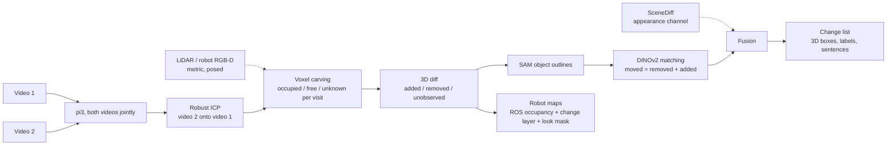

# Knowledge map

Start here. Every other doc is linked from this page. Update the status board at the end of each work unit.

## Status board (2026-10-12)

| Area | State | Next action | Owner |
|---|---|---|---|
| Architecture (D11) | **decided**: pi3 -> ICP -> voxel carving -> SAM -> DINOv2 matching; SceneDiff as a second channel | | done |
| Change type (D12) | **decided**: added / removed first, moved is a bonus | | done |
| Model choice (S5, S10, S12) | **pi3** beats Pi3X, VGGT, DA3, MapAnything, VGGT-Omega on the benchmark | | done |
| Benchmark (S9) | tuning 34.3, held-out 18.0 vs SceneDiff 32.0, fusion 33.0 (5 pairs, too few) | 30-pair held-out test (~$6.5) when wanted | user |
| Own rooms (S9e, S11) | pair01 5 of 6 (SceneDiff 3), pair02 4 of 4 + boot unobserved (SceneDiff 3) | | done |
| Robot maps (`grid2d`, `level`, `tools/make_grid.py`) | **works**: ROS map_server before/after maps, change layer, look mask; boot corner flagged | suggested viewpoints for LOOK cells | Claude |
| False alarms (walls, edges, shadow) | open: about as many as SceneDiff | size / views / wall-plane filter, tuned on benchmark | Claude |
| Isaac diff-drive demo | not started (S3: laptop renders 9.4 fps) | after viewpoints | Claude |
| README + design note | not started | last day | Claude |

## Pipeline (as built, D11)

## Data sources

| Source | Size | Labels | Licence | Where | Role |
|---|---|---|---|---|---|
| SceneDiff benchmark | 350 pairs (100 val / 250 test) | 2D masks + change type | MIT | Modal volume `scenediff:/scenediff_benchmark` | baseline + headline test |
| 3RScan | 1,004 rescans, 3,323 3D moves | 3D transforms, removed | CC BY-NC-SA 4.0 | metadata `data/raw/3rscan/3RScan.json`; scans not downloaded | candidate real 3D training data |
| Own iPhone pairs | 2 (pair01 bedroom, pair02 corridor with mirror) | own notes + photos + ARKit + LiDAR | ours | `data/raw/pairNN/` | demo + real test |
| Isaac Sim synthetic | 0 (renderer proven, S3) | exact 3D | ours | `spikes/s3_isaac_render.py` | optional; robot demo env |

## Models and weights

| Model | Use | Access | Where |
|---|---|---|---|
| pi3 | our reconstruction (D11) and SceneDiff's | open (non-commercial) | Modal volume `hf-cache` |
| SAM ViT-H (v1) | our object outlines (laptop) and SceneDiff's masks | open | `~/.cache/roomdiff/sam_vit_h.pth`, Modal image |
| DINOv2 ViT-S/14 | our moved matching | open | torch hub cache |
| DINOv3 ViT-H+/16 | SceneDiff features | granted; links expire 2026-10-13 | Modal volume `scenediff:/weights` |
| Pi3X, VGGT, VGGT-Omega, DA3, MapAnything | model comparison only (S5, S10, S12) | VGGT-Omega gated (Modal secret `huggingface`) | Modal volume `hf-cache` |

## Documents

| Doc | What it holds |
|---|---|
| [challenge.md](challenge.md) | the brief, verbatim |
| [decisions.md](decisions.md) | D1-D12, each with reason; append-only |
| [spikes.md](spikes.md) | S1-S12 with pre-written rules and results; summary table at the top |
| [ideas.md](ideas.md) | ideas not built (Isaac pairs, co-training, 3RScan, mirrors) |
| [deep-research.md](deep-research.md) | state-of-the-art report with ranked choices, plus later paper checks |
| `research-notes/` | raw notes behind the deep research |

## Code

| Path | What |
|---|---|
| `src/roomdiff/pipeline.py` | the pipeline on one pair: `run` (plain video recon) or `run_lidar` (Stray LiDAR), one change map |
| `src/roomdiff/frames.py` | one posed-depth container for LiDAR and every model |
| `src/roomdiff/align.py` | gravity-aware 4-DoF registration of two LiDAR captures; robust ICP between videos |
| `src/roomdiff/visibility.py` | voxel carving: occupied / free / unknown per visit, compare, components |
| `src/roomdiff/changemap.py` | sparse 3D change map, blob -> 2D masks, SceneDiff export with moved merging |
| `src/roomdiff/objects.py` | SAM object outlines, DINOv2 descriptor, moved matcher |
| `src/roomdiff/level.py` | floor and up in a reconstruction, scale from phone height |
| `src/roomdiff/grid2d.py` | robot maps: ROS map_server occupancy, change layer, look mask |
| `src/roomdiff/metrics.py` | Umeyama Sim3, ATE, depth AbsRel |
| `src/roomdiff/io/stray.py` | Stray Scanner loader (poses already OpenCV axes) |
| `tools/run_pair.py` | pipeline on one recon with a picture per change |
| `tools/make_grid.py` | robot maps from a recon or a LiDAR pair |
| `tools/bench_predict.py`, `tools/s9_sweep.sh` | benchmark predictions (final settings by default) + official evaluator |
| `tools/fuse.py` | SceneDiff rescored by 3D support, plus 3D-only objects |
| `tools/score_recon.py` | S5 model scorer vs ARKit + LiDAR |
| `tools/show_sd.py`, `tools/show_pair.py`, `tools/plot_s9.py` | pictures: SceneDiff detections, benchmark pairs, results chart |
| `infra/modal_scenediff.py` | Modal: benchmark, SceneDiff, pi3 reconstruction, evaluator |
| `infra/modal_models.py` | Modal: Pi3X, VGGT, VGGT-Omega, DA3, MapAnything (model comparison) |
| `spikes/s3_isaac_render.py` | Isaac render benchmark |
| `third_party/` | SceneDiff clone, 3RScan download script (untracked) |
