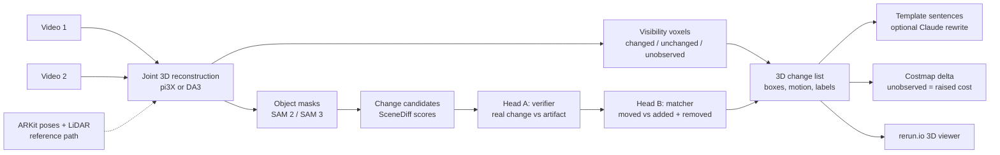

# Knowledge map

Start here. Every other doc is linked from this page. Update the status board at the end of each work unit.

## Status board (2026-10-11)

| Area | State | Next action | Owner |
|---|---|---|---|
| S1 SceneDiff on 5 val pairs (Modal) | running (2nd attempt; env fixed) | read metrics, apply rule | Claude |
| S2 own phone pair | waiting for capture | film pair01, write down 3 changes | user |
| S3 Isaac render speed | **PASS** 9.4 fps, 4.4 GB | none | done |
| S4 keyless vs gated models | blocked on S1 | run after S1 | Claude |
| S5 pi3X vs DA3 vs ARKit poses | blocked on S2 | run after S2 | Claude |
| Training data choice (SceneDiff val / 3RScan / Isaac) | open | decide after S1 | user |
| Plan (`plan.md`) | not written | write after S1 + S2 | Claude |

## Pipeline (target design, D8)

## Data sources

| Source | Size | Labels | Licence | Where | Role |
|---|---|---|---|---|---|
| SceneDiff benchmark | 350 pairs (100 val / 250 test) | 2D masks + change type | MIT | Modal volume `scenediff:/scenediff_benchmark` | baseline + headline test |
| 3RScan | 1,004 rescans, 3,323 3D moves | 3D transforms, removed | CC BY-NC-SA 4.0 | metadata `data/raw/3rscan/3RScan.json`; scans not downloaded | candidate real 3D training data |
| Own iPhone pairs | 0 so far (target 6-10) | own notes + ARKit + LiDAR | ours | `data/raw/pairNN/` | demo + held-out real test |
| Isaac Sim synthetic | 0 (renderer proven, S3) | exact 3D | ours | `spikes/s3_isaac_render.py` | optional; robot demo env |

## Models and weights

| Model | Use | Access | Where |
|---|---|---|---|
| DINOv3 ViT-H+/16, L/16, B/16 | appearance features | granted; links expire 2026-10-13 | Modal volume `scenediff:/weights` |
| SAM ViT-H (v1) | SceneDiff masks | open | baked into Modal image |
| SAM 3 | our masks (S4) | granted (HF) | HF cache when used |
| pi3 | SceneDiff geometry | open (non-commercial) | HF cache volume `hf-cache` |

## Documents

| Doc | What it holds |
|---|---|
| [challenge.md](challenge.md) | the brief, verbatim |
| [decisions.md](decisions.md) | D1-D8, each with reason; append-only |
| [spikes.md](spikes.md) | S1-S5 with pre-written rules and results |
| [ideas.md](ideas.md) | I1 Isaac pairs, I2 co-training, I3 3RScan |
| [research.md](research.md) | first-pass notes on SceneDiff and models |
| [deep-research.md](deep-research.md) | full state-of-the-art report with ranked choices |
| `../research_notes/` | raw notes behind the deep research |

## Code

| Path | What |
|---|---|
| `infra/modal_scenediff.py` | SceneDiff on Modal: download, fetch_weights, smoke, predict, evaluate |
| `spikes/s3_isaac_render.py` | Isaac render benchmark |
| `src/roomdiff/io/stray.py` | Stray Scanner loader (ARKit -> OpenCV poses, depth, backprojection), 9 tests |
| `third_party/` | SceneDiff clone, 3RScan download script (untracked) |

## Open questions
1. Does SceneDiff work on a white-walled home captured with a phone? (S2)
2. Where does SceneDiff fail on val: missed changes, false alarms, or wrong change type? This decides what head A and B must fix. (S1 per-pair breakdown)
3. Training data for the heads: SceneDiff val alone, plus 3RScan, or plus Isaac?
