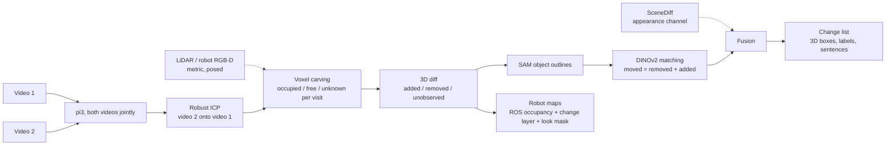

# Knowledge map

Start here. Every other doc is linked from this page. Update the status board at the end of each work unit.

## Status board (2026-10-12)

| Area | State | Next action | Owner |
|---|---|---|---|
| Architecture (D11) | **decided**: pi3 -> ICP -> voxel carving -> SAM -> DINOv2 matching; SceneDiff as a second channel | | done |
| Change type (D12) | **decided**: added / removed first, moved is a bonus | | done |
| Model choice (S5, S10, S12) | **pi3** beats Pi3X, VGGT, DA3, MapAnything, VGGT-Omega on the benchmark | | done |
| Benchmark (S9) | tuning 34.3, held-out 18.0 vs SceneDiff 32.0, fusion 33.0 (5 pairs, too few) | 30-pair held-out test (~$6.5) when wanted | user |
| Own rooms (S9e, S11) | pair01 5 of 6 (SceneDiff 3), pair02 4 of 4 + boot unobserved (SceneDiff 3) | | done |
| Robot maps (`grid2d`, `level`, `tools/make_grid.py`) | **works**: ROS map_server before/after maps, change layer, look mask; boot corner flagged | suggested viewpoints for LOOK cells | Claude |
| False alarms (walls, edges, shadow) | open: about as many as SceneDiff | size / views / wall-plane filter, tuned on benchmark | Claude |
| Isaac diff-drive demo | not started (S3: laptop renders 9.4 fps) | after viewpoints | Claude |
| README + design note | not started | last day | Claude |

## Pipeline (as built, D11)

## Data sources

| Source | Size | Labels | Licence | Where | Role |
|---|---|---|---|---|---|
| SceneDiff benchmark | 350 pairs (100 val / 250 test) | 2D masks + change type | MIT | Modal volume `scenediff:/scenediff_benchmark` | baseline + headline test |
| 3RScan | 1,004 rescans, 3,323 3D moves | 3D transforms, removed | CC BY-NC-SA 4.0 | metadata `data/raw/3rscan/3RScan.json`; scans not downloaded | candidate real 3D training data |
| Own iPhone pairs | 0 so far (target 6-10) | own notes + ARKit + LiDAR | ours | `data/raw/pairNN/` | demo + held-out real test |
| Isaac Sim synthetic | 0 (renderer proven, S3) | exact 3D | ours | `spikes/s3_isaac_render.py` | optional; robot demo env |

## Models and weights

| Model | Use | Access | Where |
|---|---|---|---|
| DINOv3 ViT-H+/16, L/16, B/16 | appearance features | granted; links expire 2026-10-13 | Modal volume `scenediff:/weights` |
| SAM ViT-H (v1) | SceneDiff masks | open | baked into Modal image |
| SAM 3 | our masks (S4) | granted (HF) | HF cache when used |
| pi3 | SceneDiff geometry | open (non-commercial) | HF cache volume `hf-cache` |

## Documents

| Doc | What it holds |
|---|---|
| [challenge.md](challenge.md) | the brief, verbatim |
| [decisions.md](decisions.md) | D1-D8, each with reason; append-only |
| [spikes.md](spikes.md) | S1-S5 with pre-written rules and results |
| [ideas.md](ideas.md) | I1 Isaac pairs, I2 co-training, I3 3RScan |
| [research.md](research.md) | first-pass notes on SceneDiff and models |
| [deep-research.md](deep-research.md) | full state-of-the-art report with ranked choices |
| `../research_notes/` | raw notes behind the deep research |

## Code

| Path | What |
|---|---|
| `infra/modal_scenediff.py` | SceneDiff on Modal: download, fetch_weights, smoke, predict, evaluate |
| `spikes/s3_isaac_render.py` | Isaac render benchmark |
| `src/roomdiff/io/stray.py` | Stray Scanner loader (poses already OpenCV axes, depth, backprojection), 10 tests |
| `src/roomdiff/align.py` | register two captures: gravity yaw sweep + FFT shift + 4-DoF ICP, 2 tests |
| `src/roomdiff/visibility.py` | voxel carving -> removed / added / unchanged / unobserved, 6 tests |
| `src/roomdiff/keyframes.py` | sharpness, finger mask, window and coverage keyframe selection, 9 tests |
| `tools/visibility_map.py` | S7 map on a pair: result.json, labels.npz, bev.png, blobs.jpg |
| `tools/make_keyframe_pair.py`, `tools/filter_occluded.py` | S6 keyframe pair and finger filter |
| `src/roomdiff/frames.py` | one posed-depth container for LiDAR and every model |
| `src/roomdiff/changemap.py` | 3D-first change map (sparse carving), blob -> 2D masks, SceneDiff export, moved matching |
| `src/roomdiff/objects.py` | SAM object layer, colour and DINOv2 descriptors, moved matcher |
| `src/roomdiff/metrics.py` | Umeyama Sim3, ATE, depth AbsRel |
| `infra/modal_models.py` | Pi3X, VGGT, DA3, MapAnything on Modal, same frames and format |
| `tools/score_recon.py` | S5 scorer vs ARKit + LiDAR |
| `tools/bench_predict.py`, `tools/s9_sweep.sh`, `tools/fuse.py`, `tools/plot_s9.py` | benchmark export, sweeps with official evaluator, fusion, chart |
| `tools/run_pair.py` | full pipeline on one pair with pictures |
| `third_party/` | SceneDiff clone, 3RScan download script (untracked) |

## Open questions
1. Does SceneDiff work on a white-walled home captured with a phone? (S2)
2. Where does SceneDiff fail on val: missed changes, false alarms, or wrong change type? This decides what head A and B must fix. (S1 per-pair breakdown)
3. Training data for the heads: SceneDiff val alone, plus 3RScan, or plus Isaac?
