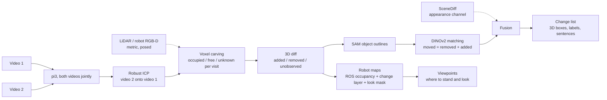

# Knowledge map

Start here. Every other doc is linked from this page. Update the status board at the end of each work unit.

## Status board (2026-10-15)

| Area | State | Next action | Owner |
|---|---|---|---|
| Architecture (D11) | **decided**: pi3 -> ICP -> voxel carving -> SAM -> DINOv2 matching -> VLM names | | done |
| End to end (`roomdiff run`) | **works**: two videos -> viewer.html + summary.json; local GPU or `--modal`; pair01 via the new path reproduces s20 to 1 mm | local smoke test on the 8 GB laptop | Claude |
| Public page | **live**: https://termvato--roomdiff-app-web.us-east.modal.run, 20 runs/day; pair02 run and a refused two-room pair tested | take down after hiring | user |
| Room check (S22, S23) | refuses image score < 0.45, warns 3D overlap < 0.40 | | done |
| 3D viewer | **works**: examples/pair01_bedroom.html, pair02_corridor.html (from the final runs, outputs/e2e); moves drawn as red-to-green arrows; README demo GIF | | done |
| Own rooms (S18-S20, final) | pair01 5/6, 1 confident false alarm; pair02 4/4 (3 confident), 2 confident false alarms | | done |
| Benchmark (S9, S17) | held-out 23.1 (typed 21.4) vs SceneDiff 32.0 (typed 15.8); 5 pairs | | done |
| VLM verdict | noisy (S19-S21); tuning stopped (D17) | | done |
| Fold pieces into moved (S24) | not adopted: nothing to fold on 3 rooms; the suitcase grip is 21 cm off | | done |
| README + design note | written: README.md, docs/design.md, demo GIF; soft-object false alarms explained | repo URL in README, push, submit (planned 2026-10-15) | user |
| Docker image | not made: docker not installed here, untested images are not shipped | | |

## Pipeline (as built, D11)

## Data sources

| Source | Size | Labels | Licence | Where | Role |
|---|---|---|---|---|---|
| SceneDiff benchmark | 350 pairs (100 val / 250 test) | 2D masks + change type | MIT | Modal volume `scenediff:/scenediff_benchmark` | baseline + headline test |
| 3RScan | 1,004 rescans, 3,323 3D moves | 3D transforms, removed | CC BY-NC-SA 4.0 | metadata `data/raw/3rscan/3RScan.json`; scans not downloaded | candidate real 3D training data |
| Own iPhone pairs | 2 (pair01 bedroom, pair02 corridor with mirror) | own notes + photos + ARKit + LiDAR | ours | `data/raw/pairNN/` | demo + real test |
| Isaac Sim synthetic | 0 (renderer proven, S3) | exact 3D | ours | `spikes/s3_isaac_render.py` | optional; robot demo env |

## Models and weights

| Model | Use | Access | Where |
|---|---|---|---|
| pi3 | our reconstruction (D11) and SceneDiff's | open (non-commercial) | Modal volume `hf-cache` |
| SAM ViT-H (v1) | our object outlines (laptop) and SceneDiff's masks | open | `~/.cache/roomdiff/sam_vit_h.pth`, Modal image |
| DINOv2 ViT-S/14 | our moved matching | open | torch hub cache |
| DINOv3 ViT-H+/16 | SceneDiff features | granted; links expire 2026-10-13 | Modal volume `scenediff:/weights` |
| Pi3X, VGGT, VGGT-Omega, DA3, MapAnything | model comparison only (S5, S10, S12) | VGGT-Omega gated (Modal secret `huggingface`) | Modal volume `hf-cache` |

## Documents

| Doc | What it holds |
|---|---|
| [challenge.md](challenge.md) | the brief, verbatim |
| [decisions.md](decisions.md) | D1-D12, each with reason; append-only |
| [spikes.md](spikes.md) | S1-S12 with pre-written rules and results; summary table at the top |
| [design.md](design.md) | the short design note for reviewers: choices, tradeoffs, honest results |
| [ideas.md](ideas.md) | ideas not built (Isaac pairs, co-training, 3RScan, mirrors) |
| [deep-research.md](deep-research.md) | state-of-the-art report with ranked choices, plus later paper checks |
| `research-notes/` | raw notes behind the deep research |

## Code

| Path | What |
|---|---|
| `src/roomdiff/cli.py`, `run.py` | `roomdiff run / serve / view`: two videos -> everything |
| `src/roomdiff/recon.py` | pi3 on both videos (no SceneDiff needed), focal from point maps |
| `src/roomdiff/analyse.py`, `labelling.py`, `vlm.py` | change list, maps, crops; VLM names and verdicts |
| `src/roomdiff/view3d.py`, `viewer.html` | the 3D viewer page |
| `src/roomdiff/web.py`, `upload.html`, `remote.py` | upload page; local or Modal job runner |
| `src/roomdiff/roomcheck.py` | same-room check (S22) |
| `src/roomdiff/pipeline.py` | the pipeline on one pair: `run` (plain video recon) or `run_lidar` (Stray LiDAR), one change map |
| `src/roomdiff/frames.py` | one posed-depth container for LiDAR and every model |
| `src/roomdiff/align.py` | gravity-aware 4-DoF registration of two LiDAR captures; robust ICP between videos |
| `src/roomdiff/visibility.py` | voxel carving: occupied / free / unknown per visit, compare, components |
| `src/roomdiff/changemap.py` | sparse 3D change map, blob -> 2D masks, SceneDiff export with moved merging |
| `src/roomdiff/objects.py` | SAM object outlines, DINOv2 descriptor, moved matcher |
| `src/roomdiff/level.py` | floor and up in a reconstruction, scale from phone height |
| `src/roomdiff/grid2d.py` | robot maps: ROS map_server occupancy, change layer, look mask, obstacle heights |
| `src/roomdiff/viewpoints.py` | where to stand to look at each "go look" region (2.5D line of sight) |
| `src/roomdiff/metrics.py` | Umeyama Sim3, ATE, depth AbsRel |
| `src/roomdiff/io/stray.py` | Stray Scanner loader (poses already OpenCV axes) |
| `tools/analyse.py` | **the one command**: change list, pictures, robot maps, viewpoints for a recon, sim or LiDAR pair |
| `src/roomdiff/report.py` | 3D change list: added / removed / moved (from -> to, distance) in map metres |
| `isaac/scene.py`, `isaac/record_visits.py` | simulated test room with known changes; two visits as exact posed RGB-D |
| `tools/bench_predict.py`, `tools/s9_sweep.sh` | benchmark predictions (final settings by default) + official evaluator |
| `tools/fuse.py` | SceneDiff rescored by 3D support, plus 3D-only objects |
| `tools/score_recon.py` | S5 model scorer vs ARKit + LiDAR |
| `tools/show_sd.py`, `tools/show_pair.py`, `tools/plot_s9.py` | pictures: SceneDiff detections, benchmark pairs, results chart |
| `infra/modal_app.py` | Modal: whole pipeline on one GPU + the public upload page |
| `infra/modal_scenediff.py` | Modal: benchmark, SceneDiff, pi3 reconstruction, evaluator, mixed-room pairs |
| `infra/modal_models.py` | Modal: Pi3X, VGGT, VGGT-Omega, DA3, MapAnything (model comparison) |
| `spikes/s3_isaac_render.py` | Isaac render benchmark |
| `third_party/` | SceneDiff clone, 3RScan download script (untracked) |
